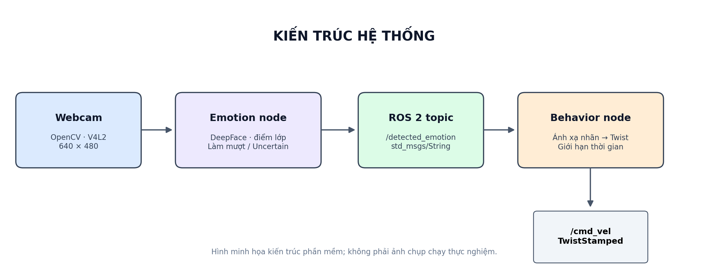
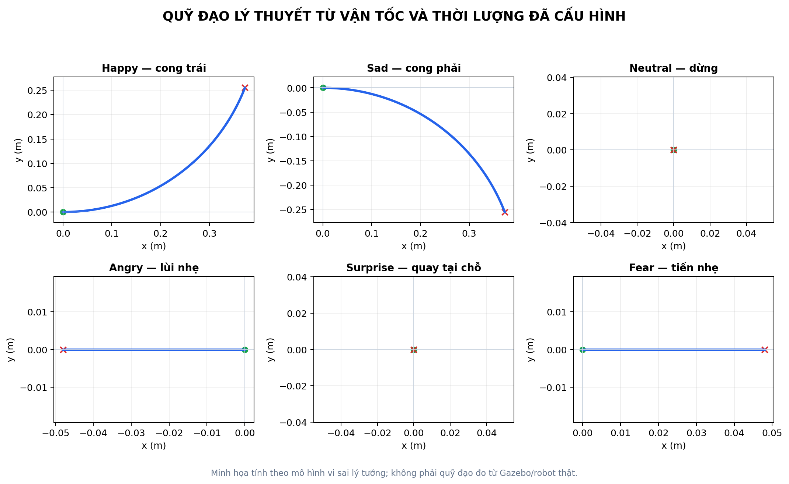

# BÁO CÁO BÀI THỰC HÀNH

## Nhận diện biểu cảm khuôn mặt và điều khiển TurtleBot 4 bằng ROS 2

**Sinh viên:** ........................................................  
**Lớp:** ...............................................................  
**Giảng viên:** .......................................................  
**Ngày:** 13/11/2026  
**Nền tảng phát triển:** Ubuntu 24.04, ROS 2 Jazzy, Python 3.12  

> **Tính trung thực của kết quả:** Báo cáo mô tả đúng source hiện có và các bước đã chạy. Package đã build thành công. Log các phiên trước cho thấy webcam mở được và từng gửi nhãn `Angry` tới node điều khiển, nhưng chưa có bằng chứng chạy đầu-cuối sau các cập nhật gần nhất và chưa có ảnh chụp Gazebo cho từng hành vi. Hình trong báo cáo là sơ đồ/quỹ đạo lý thuyết, không được trình bày như ảnh chụp thí nghiệm.

## Tóm tắt

Bài thực hành kết nối webcam, OpenCV, DeepFace và ROS 2 để ước lượng biểu cảm khuôn mặt, sau đó chuyển nhãn sang vận tốc TurtleBot 4. Node nhận diện hiển thị webcam ở luồng riêng và chạy suy luận DeepFace nền. Điểm cảm xúc được làm mượt qua nhiều lần suy luận; kết quả mơ hồ được gắn `Uncertain` để node điều khiển dừng robot. Node hành vi xuất `geometry_msgs/msg/TwistStamped` lên `/cmd_vel`.

Package tích hợp sáu trạng thái theo yêu cầu: Happy, Sad, Neutral, Angry, Surprise và Fear. Workspace đã build `tb4_assignment` thành công. Bản đóng gói GitHub đi kèm dùng tên package riêng `tb4_emotion_control` để tránh trùng package với workspace đang có.

## 1. Mục tiêu

- Thu hình webcam bằng OpenCV.
- Phân loại sáu biểu cảm mục tiêu bằng DeepFace.
- Hiển thị nhãn và điểm lớp trên khung hình.
- Gửi trạng thái qua `/detected_emotion`.
- Điều khiển robot bằng `/cmd_vel` theo ánh xạ vận tốc có giới hạn thời gian.
- Dừng khi không có khuôn mặt, tín hiệu mơ hồ, lỗi camera hoặc timeout.

## 2. Môi trường và kiến trúc

### 2.1 Môi trường

| Thành phần | Cấu hình |
|---|---|
| Hệ điều hành | Ubuntu 24.04 |
| ROS | ROS 2 Jazzy |
| Python ROS | Python 3.12 |
| Thư viện hình ảnh | OpenCV 4.11.0 |
| Nhận diện | DeepFace 0.0.93, TensorFlow 2.21.0, tf-keras 2.21.0 |
| Middleware | Fast DDS (`rmw_fastrtps_cpp`) |
| Camera | OpenCV V4L2; thiết bị mặc định index 0; OpenCV face detector |

### 2.2 Luồng dữ liệu



*Hình 1. Sơ đồ kiến trúc minh họa, không phải ảnh chụp giao diện chạy.*

Node webcam phân tích khung hình với `DeepFace.analyze(actions=['emotion'])`, backend mặc định `opencv`, căn chỉnh khuôn mặt và mở rộng vùng cắt 5%. Chỉ khuôn mặt detect được, rộng tối thiểu 60 pixel mới được phân loại; nếu detector không tìm thấy mặt, toàn bộ khung hình không bị đưa nhầm qua bộ phân loại. Điểm lớp được làm mượt theo 3 lần suy luận gần nhất. Nếu điểm cao nhất thấp hơn `confidence`, hoặc khoảng cách tới lớp thứ hai thấp hơn ngưỡng cặp, node phát `Uncertain`; Happy/Surprise cần chênh lệch ít nhất 0,15, Fear/Surprise 0,12, Angry/Sad 0,08. Node hành vi coi nhãn không hợp lệ là dừng và cho phép nhận diện lại ở lần kế tiếp. Log ROS ghi nhãn khi trạng thái thay đổi để hỗ trợ chẩn đoán.

### 2.3 Thành phần

| Tệp | Nhiệm vụ |
|---|---|
| `scripts/emotion_recognition_node.py` | Webcam, DeepFace, làm mượt điểm, vẽ nhãn và phát `/detected_emotion`. |
| `scripts/emotion_behavior_node.py` | Ánh xạ trạng thái thành `TwistStamped` giới hạn thời gian trên `/cmd_vel`. |
| `launch/emotion_control.launch.py` | Chạy node hành vi và tiến trình camera cùng lúc. |
| `requirements-emotion.txt` | Khóa phiên bản thư viện Python cho môi trường nhận diện. |

## 3. Phương pháp phân loại và lọc kết quả

DeepFace cung cấp điểm cho các lớp angry, disgust, fear, happy, sad, surprise và neutral. Chương trình chuyển điểm về khoảng 0–1, làm mượt các khung hình gần nhất rồi xếp hạng. Nhãn trong sáu trạng thái bài tập được chuyển thành chữ hoa đầu; các lớp khác không được ánh xạ hành vi nên robot dừng.

Tham số launch mặc định:

| Tham số | Mặc định | Tác dụng |
|---|---:|---|
| `confidence` | 0.32 | Điểm thấp hơn ngưỡng sẽ thành `Uncertain`. |
| `emotion_margin` | 0.04 | Khoảng cách tối thiểu chung giữa hai lớp cao nhất. |
| `happy_surprise_margin` | 0.15 | Khoảng cách riêng khi hai lớp cao nhất là Happy và Surprise. |
| `smoothing_window` | 3 | Số kết quả gần nhất dùng để làm mượt. |
| `detector_backend` | `opencv` | Bộ phát hiện mặt nhanh; thử `retinaface` nếu detector không bắt được mặt và máy đủ CPU. |
| `frame_rate` | 2 FPS | Tần số suy luận AI, độc lập với preview. |
| `display_rate` | 30 FPS | Tần số đọc/hiển thị webcam mục tiêu. |

> Các ngưỡng là tham số thực nghiệm ban đầu, không phải hiệu chuẩn cho mọi webcam/người dùng. Giảm ngưỡng làm tăng số nhãn được chấp nhận nhưng có thể tăng phân loại sai. Cần xem điểm các lớp trên overlay để hiệu chỉnh trên máy chạy thật.

### 3.1 Tiêu chí biểu cảm theo ảnh tham chiếu

Ảnh bài tập dùng các biểu cảm chính diện và khá phóng đại. Happy có khóe miệng nâng/cười; Sad có lông mày trong nâng và khóe miệng trễ xuống; Neutral thả lỏng; Angry có lông mày kéo xuống/gần nhau và môi mím; Surprise có lông mày nâng, mắt mở lớn và miệng tròn mở; Fear có mắt mở lớn nhưng miệng kéo ngang/căng hơn. Vì Fear và Surprise cùng mở to mắt, chương trình áp dụng chênh lệch điểm riêng và dừng khi hai lớp quá sát thay vì đoán. Bộ phân loại không được huấn luyện trực tiếp từ một ảnh ghép đơn lẻ; muốn cá nhân hóa đáng tin cậy cần nhiều mẫu webcam cho mỗi lớp và kiểm tra trên mẫu độc lập.

## 4. Ánh xạ biểu cảm và quỹ đạo

| Biểu cảm | Vận tốc tuyến tính x (m/s) | Vận tốc góc z (rad/s) | Thời lượng | Hành vi |
|---|---:|---:|---:|---|
| Happy | +0.12 | +0.30 | 4.0 s | Cong sang trái |
| Sad | +0.12 | −0.30 | 4.0 s | Cong sang phải |
| Neutral | 0 | 0 | tức thời | Dừng |
| Angry | −0.08 | 0 | 0.6 s | Lùi nhẹ |
| Surprise | 0 | +0.50 | khoảng 12.57 s | Quay tại chỗ một vòng theo mô hình lý tưởng |
| Fear | +0.08 | 0 | 0.6 s | Tiến nhẹ |
| Không mặt / Uncertain / lỗi / timeout | 0 | 0 | tức thời | Dừng |



*Hình 2. Quỹ đạo tính từ vận tốc và thời lượng cấu hình theo mô hình unicycle lý tưởng; đây không phải quỹ đạo đo từ robot/Gazebo. Góc quay thực tế phụ thuộc odometry, gia tốc và bộ điều khiển.*

Node xuất vận tốc ở 20 Hz. Hành vi mỗi nhãn chỉ khởi chạy một lần cho đến khi nhãn thay đổi hoặc nhận trạng thái không hợp lệ. `linear_scale` và `angular_scale` giảm tốc độ theo hệ số trong (0, 1]. `signal_timeout` mặc định 3 giây; nếu mất tín hiệu, robot dừng.

## 5. Cài đặt và chạy

### 5.1 Cài dependencies và build trong workspace hiện có

```bash
sudo apt update
sudo apt install python3-opencv python3-venv python3-pip
cd ~/tb4_slam_ws
source /opt/ros/jazzy/setup.bash
python3 -m venv --system-site-packages .venv-emotion
.venv-emotion/bin/python -m pip install --default-timeout=1800 --retries 10 -r requirements-emotion.txt
.venv-emotion/bin/python -c "import rclpy, cv2; from deepface import DeepFace; print('Imports OK')"
colcon build --symlink-install --packages-select tb4_assignment
source install/setup.bash
```

Nếu đã tạo `.venv-emotion` trước đó thì không tạo lại khi đang chạy node. Nếu OpenCV GUI bị wheel headless ghi đè, cài lại `opencv-python==4.11.0.86` trong venv và kiểm tra `cv2.getBuildInformation()` có GUI QT/GTK.

### 5.2 Khởi động mô phỏng và nhận diện

Terminal 1 khởi chạy mô phỏng TurtleBot 4 theo cấu hình workspace:

```bash
cd ~/tb4_slam_ws
source /opt/ros/jazzy/setup.bash
source install/setup.bash
export ROS_DOMAIN_ID=23
export RMW_IMPLEMENTATION=rmw_fastrtps_cpp
ros2 launch tb4_assignment sim_mapping.launch.py
```

Terminal 2, sau khi Gazebo và motion controller sẵn sàng:

```bash
cd ~/tb4_slam_ws
source /opt/ros/jazzy/setup.bash
source install/setup.bash
export ROS_DOMAIN_ID=23
export RMW_IMPLEMENTATION=rmw_fastrtps_cpp
ros2 launch tb4_assignment emotion_control.launch.py \
  python_executable:="$PWD/.venv-emotion/bin/python" \
  camera_index:=0 use_sim_time:=true \
  confidence:=0.32 emotion_margin:=0.04 \
  happy_surprise_margin:=0.15 smoothing_window:=3 \
  detector_backend:=opencv
```

Nhấn `q` trong preview hoặc `Ctrl+C` để dừng. Nếu camera index 0 không phải webcam cần dùng, thử `camera_index:=1`. Tránh chạy nhiều launch cùng lúc chiếm camera hoặc publish `/cmd_vel`.

### 5.3 Quan sát topic

```bash
ros2 topic echo /detected_emotion
ros2 topic info /cmd_vel -v
ros2 topic echo /cmd_vel
```

`/detected_emotion` dùng `std_msgs/msg/String`; `/cmd_vel` trong cấu hình hiện tại dùng `geometry_msgs/msg/TwistStamped`. Kiểm tra subscriber của `/cmd_vel` có motion controller trước khi đánh giá chuyển động.

## 6. Kiểm chứng có thể khẳng định

| Hạng mục | Kết quả | Cơ sở |
|---|---|---|
| Source nhận diện, điều khiển và launch | Có trong package | Đã đối chiếu các tệp source. |
| Build ROS package | Thành công | `colcon build --symlink-install --packages-select tb4_assignment` kết thúc với `1 package finished`. |
| Build bản package GitHub độc lập | Thành công | `colcon build --base-paths src --symlink-install --packages-select tb4_emotion_control` kết thúc thành công. |
| Webcam được hệ điều hành liệt kê | Có `/dev/video0`, `/dev/video1` tại lần kiểm tra | Chưa tự nó chứng minh OpenCV mở được thiết bị trong lần chạy mới. |
| Webcam và DeepFace ở phiên trước | Log cũ báo camera mở và một kết quả `Angry` tới behavior node | Log đó có trước cập nhật cuối; không dùng làm bằng chứng cho độ chính xác hiện tại. |
| Sáu biểu cảm được phân loại ổn định | Chưa nghiệm thu | Chưa có bộ ảnh kiểm thử gán nhãn hoặc log điểm riêng cho từng biểu cảm. |
| Sáu hành vi robot trên Gazebo/robot thật | Chưa nghiệm thu | Chưa có video/ảnh hoặc odometry đo sau cập nhật. |

### 6.1 Ảnh bằng chứng thực nghiệm cần chụp khi chạy

Workspace hiện không có ảnh chụp màn hình webcam hoặc Gazebo của bài nhận diện cảm xúc. Không dùng ảnh từ bài điều khiển cử chỉ để thay thế. Để hoàn thiện nghiệm thu, chụp và bổ sung các ảnh sau:

1. Webcam với khuôn mặt trước camera, nhãn và các điểm lớp trên overlay.
2. Terminal có các nhãn `/detected_emotion` khi lần lượt thử sáu biểu cảm.
3. Gazebo/robot khi thực hiện Happy, Sad, Angry, Surprise và Fear; ảnh Neutral thể hiện robot đứng yên.
4. Terminal `ros2 topic info /cmd_vel -v` chứng minh subscriber motion controller.

Các hình ở Hình 1–2 chỉ là sơ đồ và kết quả mô phỏng toán học, không thay thế các ảnh thực nghiệm trên.

## 7. Hạn chế và an toàn

- Mô hình phân loại biểu cảm từ ảnh, không đo trạng thái tâm lý. Ánh sáng, góc mặt, che khuất, khoảng cách và cách thể hiện ảnh hưởng mạnh đến điểm.
- DeepFace có thể nhầm các lớp gần nhau. Đặc biệt Happy/Surprise được lọc chặt hơn; xem điểm overlay và hiệu chỉnh thay vì coi nhãn là sự thật chắc chắn.
- Không có tránh vật cản trong node hành vi. Chạy trong vùng trống, tốc độ thấp, có người giám sát và sẵn sàng dừng khẩn cấp.
- Không dùng đồng thời Nav2, teleop hoặc publisher khác trên `/cmd_vel` trong lúc chạy thử.
- Chưa đo FPS sau cập nhật và chưa đo góc quay bằng odometry.

## 8. Kết luận

Bài thực hành đã được tích hợp thành hai node ROS 2, launch riêng, overlay camera, lọc kết quả mơ hồ và ánh xạ sáu trạng thái sang lệnh vận tốc. Package trong workspace build thành công. Độ ổn định nhận diện và hành vi robot đầu-cuối vẫn cần được ghi nhận bằng phiên chạy thực tế; báo cáo không khẳng định các phép thử chưa có bằng chứng đã đạt.

## Tài liệu tham khảo

1. DeepFace, mã nguồn mô hình phân loại cảm xúc: <https://github.com/serengil/deepface/blob/master/deepface/models/demography/Emotion.py>.
2. DeepFace face detection, giải thích `enforce_detection` và danh sách detector: <https://github.com/serengil/deepface/blob/master/deepface/modules/detection.py>.
3. ROS 2 Jazzy Documentation: <https://docs.ros.org/en/jazzy/>.
4. OpenCV Documentation: <https://docs.opencv.org/>.
